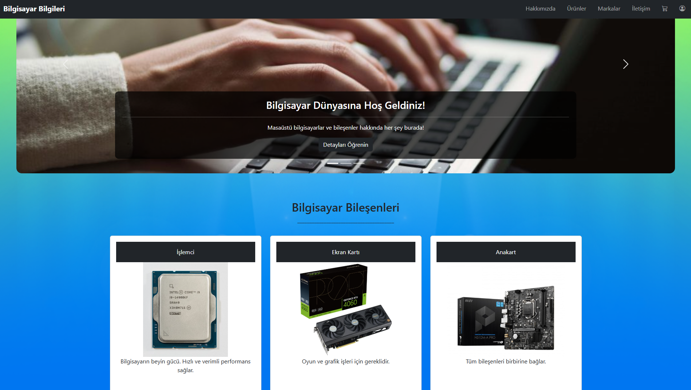
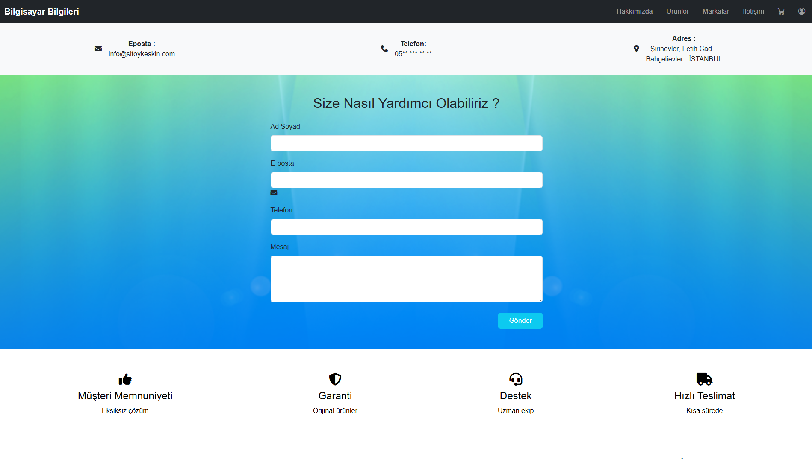
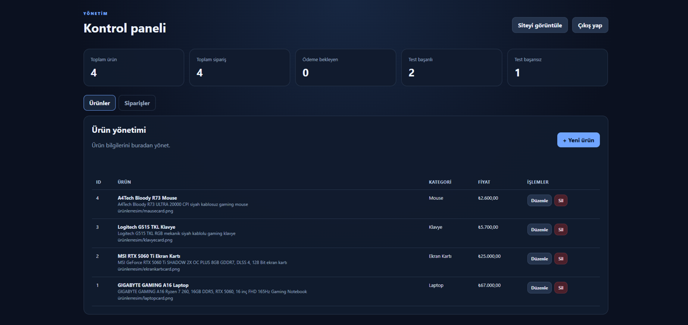

# Bilgisayar Bilgileri

A full-stack e-commerce web application for computer components, built with **Node.js, Express, PostgreSQL** and a plain **HTML / CSS / JavaScript** frontend.

The backend follows **Clean Architecture** with **CQRS**. The architecture rules are enforced by tests. The whole system runs with a single `docker compose up`.

> **Note:** The checkout flow is for testing only and does not process real payments.

---

## Quick start (Docker)

```bash
cp .env.example .env        # then fill in the values
docker compose up --build -d
```

| Service | URL |
|---|---|
| Website | http://localhost:8080 (or your `WEB_PORT`) |
| Admin panel | http://localhost:8080/admin |
| API health | http://localhost:8080/api/health, `/api/ready` |

The server refuses to start with missing or weak settings (short `SESSION_SECRET`, example passwords, and so on).

```text
Browser ──► frontend (nginx, non-root)
              ├── static pages (frontend/public)
              └── /api/* ──► backend (Node/Express, non-root, read-only) ──► db (PostgreSQL 16, internal network)
```

- Migrations run automatically when the backend starts. On an empty database, sample products are added.
- Data lives in the `db-data` volume. `docker compose down` keeps it; `docker compose down -v` deletes it.
- The database is not published to the host. For pgAdmin and similar tools:
  ```bash
  docker compose -f docker-compose.yml -f docker-compose.dev.yml up -d
  ```

### Running without Docker

You need Node.js 22+ and a local PostgreSQL.

```bash
cd backend && npm install && npm run dev          # API on http://localhost:3000/api
cd frontend && npm install && npm run dev         # site on http://localhost:8080
```

---

## Project structure

```text
.
├── docker-compose.yml          production-like stack
├── docker-compose.dev.yml      optional: publishes the database to localhost
├── docker-compose.test.yml     full test suite with a throwaway PostgreSQL
├── backend/
│   ├── src/
│   │   ├── main.js             entry point: config check → migrations → seed → HTTP
│   │   ├── bootstrap/          composition root (container.js), scheduled jobs
│   │   ├── config/             environment loading and validation
│   │   ├── domain/             pure business rules, depends on nothing
│   │   │   └── catalog/ ordering/ customers/ support/ shared/
│   │   ├── application/        use cases, one bounded context per folder
│   │   │   ├── shared/         cqrs/bus.js, ports.js
│   │   │   └── <context>/
│   │   │       ├── index.js    public surface of the context + handler registration
│   │   │       ├── commands/<UseCase>/{<UseCase>Command.js, <UseCase>Handler.js}
│   │   │       └── queries/<UseCase>/{<UseCase>Query.js, <UseCase>Handler.js}
│   │   ├── infrastructure/
│   │   │   ├── persistence/postgres/
│   │   │   │   ├── PgUnitOfWork.js   write-side transaction boundary
│   │   │   │   ├── repositories/     write side
│   │   │   │   ├── read-models/      read side, returns DTOs directly
│   │   │   │   └── migrations/  pool.js  migrate.js  seed.js
│   │   │   ├── security/       tokens, password hashing, opaque codes
│   │   │   └── mail/
│   │   └── presentation/http/  Express app, routes, middleware
│   └── tests/
│       ├── architecture/       dependency and CQRS rules
│       ├── unit/               domain, application, security, config
│       └── integration/        full API against a real PostgreSQL
├── frontend/
│   ├── nginx/default.conf      routing, CSP and security headers, /api proxy
│   ├── scripts/                vendor copy, site check, dev server
│   └── public/
│       ├── pages/              HTML pages (served as /name or /name.html)
│       └── assets/
│           ├── css/{base,pages}/
│           ├── js/core/        api client, safe html templating, cart, favorites, formatting
│           ├── js/components/  navbar, product card
│           ├── js/pages/       one ES module per page (admin/ is split by feature)
│           └── images/<section>/
└── docs/                       SECURITY.md, screenshots
```

### Dependency rule

```text
presentation ──► application ──► domain
                     ▲
infrastructure ──────┘ (implements the ports; wired only in bootstrap/container.js)
```

`tests/architecture` fails the build if a layer imports something it should not.

### CQRS

| Side | Goes through | Uses | Example |
|---|---|---|---|
| **Command** (changes state) | `commands.execute(new PlaceOrderCommand(...))` | domain rules + repositories inside a `UnitOfWork` transaction | place order, change status |
| **Query** (reads only) | `queries.ask(new ListAdminOrdersQuery(...))` | read models running SQL that returns DTOs | product list, order history, stats |

Command handlers cannot touch read models and query handlers cannot touch the unit of work; a test enforces this. Routes contain no business logic. Domain errors are mapped to HTTP status codes in `middleware/errorHandler.js`.

---

## Features

- Catalog with search and category filters, favorites, cart with quantities, test checkout
- Order tracking with a one-time code (only its SHA-256 hash is stored)
- Customer accounts: register, login with "remember me", profile, password change, **password reset by e-mail**, saved address pre-filling checkout, order history, self-service cancellation
- Admin panel: products (CSV import, archive/restore), stock, orders with server-side search, filters and pagination, order lifecycle, shipping info, support tickets, CSV export
- Stock is checked and reduced in the same transaction as the order (row locks prevent overselling)
- Stock returns automatically when a test payment fails, an order is cancelled, or an unpaid order expires (`ORDER_PAYMENT_TTL_MINUTES`)
- Products that appear in past orders are archived instead of deleted

## API overview

| Method | Path | Auth |
|---|---|---|
| GET | `/api/health`, `/api/ready`, `/api/products?q=&category=&ids=`, `/api/product-categories` | – |
| POST | `/api/orders`, `/api/order-tracking`, `/api/support` | – |
| POST | `/api/orders/:id/payment-summary`, `/api/orders/:id/test-payment` | tracking code; off unless `ENABLE_TEST_PAYMENTS=true` |
| POST | `/api/customers/register` · `login` · `logout` · `password/forgot` · `password/reset` | – |
| GET / PUT / POST | `/api/customers/session` · `address` · `profile` · `password` · `orders` · `orders/:id/cancel` | customer |
| POST | `/api/admin/login` · `logout` | – |
| GET / POST / PUT / PATCH / DELETE | `/api/admin/stats` · `products` · `products/bulk` · `products/:id/restore` · `orders` · `support` | admin |

## Tests

```bash
# Everything, including the API against a throwaway PostgreSQL (no real data or SMTP is touched)
docker compose -f docker-compose.test.yml up --build --abort-on-container-exit --exit-code-from tests
docker compose -f docker-compose.test.yml down -v

# Without Docker: unit and architecture tests only
cd backend && npm run test:unit

# Frontend: broken links, inline scripts/styles that CSP would block
cd frontend && npm run check
```

## Going live

See [docs/SECURITY.md](docs/SECURITY.md). At minimum: put HTTPS in front, then set `COOKIE_SECURE=true`, `ENABLE_TEST_PAYMENTS=false` and `PUBLIC_URL=https://your-domain`.

## Moving data from an older database

Existing tables are kept; migrations only add columns, tables and indexes. Copy the data with the stack running:

```bash
pg_dump -h <old-host> -U <old-user> --data-only <old-db> > backup.sql
docker compose exec -T db psql -U <user> <db> < backup.sql
```

Customers keep their passwords; old hashes are upgraded at next login. Everyone has to log in again once.

## Screenshots

| | |
|---|---|
|  |  |
|  |  |

---

## Developer

**Toygar Keskin** · Web Development | Node.js | Express | PostgreSQL
